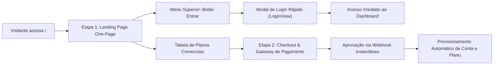
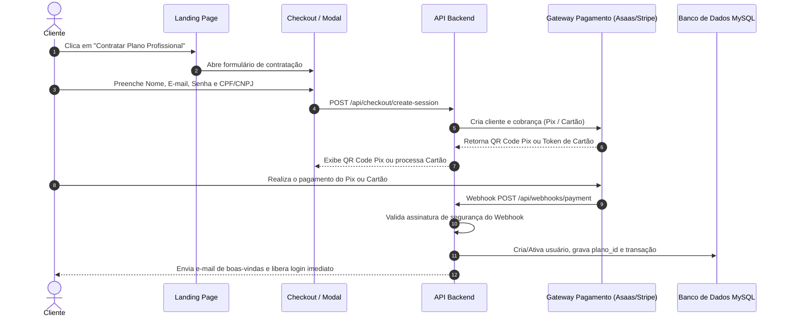

# Planejamento Estratégico: Landing Page Pública & Sistema de Assinaturas e Checkout (SaaS)

> **Documento de Especificação Técnica e Arquitetural**  
> **Status:** Em Planejamento (Aguardando Aprovação do Usuário)  
> **Data:** 17 de Outubro de 2026  
> **Módulos:** One-Page Landing Page (Etapa 1) & Gateway de Pagamento e Assinaturas (Etapa 2)

---

## 🎯 1. Visão Geral & Objetivos

Este projeto tem como meta transformar a plataforma **Validar Segurança** em um produto SaaS completo de ponta a ponta, dividindo o desenvolvimento em duas etapas bem delimitadas e complementares:



1. **Etapa 1 — Landing Page One-Page (Nova Home do SaaS):**
   - Substituir a tela de login crua na raiz (`/`) por uma One-Page moderna, responsiva, com visual tecnológico (dark mode premium) apresentando o valor comercial e os diferenciais técnicos da ferramenta.
   - Centralizar o acesso de clientes existentes através de um **Modal de Login** ativado pelo botão "Entrar" no menu superior e em botões secundários da página.
   - Exibir a vitrine de planos oficiais (**Iniciante**, **Profissional** e **Full**) e opções de add-ons com foco em conversão.

2. **Etapa 2 — Checkout, Gateway de Pagamento & Provisionamento Automático:**
   - Permitir a contratação self-service de planos e add-ons.
   - Integrar gateway de pagamento nacional com suporte a **Pix instantâneo**, **Cartão de Crédito recorrente** e **Boleto**.
   - Criar endpoint seguro de **Webhooks** com controle de idempotência para ativar a conta, vincular o plano e liberar o acesso imediatamente após a confirmação financeira.

---

## 🚀 ETAPA 1: Landing Page One-Page (Nova Home Pública)

### 1.1 Experiência do Usuário (UX) & Arquitetura de Navegação

Atualmente, quando um usuário deslogado acessa o sistema, o componente `App.tsx` retorna diretamente o formulário `LoginView`. Com a nova arquitetura:

- **Usuário Deslogado (Visitante):**
  - Acessa `/` e visualiza a **Landing Page completa**.
  - No menu superior fixo, o botão **"Área do Cliente" / "Entrar"** abre uma janela modal elegante contendo o formulário de login (`LoginView`), sem recarregar a página.
  - Ao autenticar com sucesso, o estado global `user` é populado no React e a aplicação transiciona instantaneamente para o painel (`OverviewDashboardView`).
- **Usuário Já Logado:**
  - Se possuir token JWT ativo no `localStorage`, o sistema pode abrir diretamente o painel de controle (Dashboard) ou exibir na Landing Page o botão *"➔ Ir para o Painel de Controle"*.

### 1.2 Mapa de Seções da Landing Page

```
┌────────────────────────────────────────────────────────────────────────┐
│ 1. Header / Navbar Fixo (Logo Patropi, Links de Âncora, Botão Login)   │
├────────────────────────────────────────────────────────────────────────┤
│ 2. Hero Section (Headline, Sub-headline, CTAs, Mockup do Radar)        │
├────────────────────────────────────────────────────────────────────────┤
│ 3. Prova de Valor: Problema vs Solução (Por que auditorias falham?)    │
├────────────────────────────────────────────────────────────────────────┤
│ 4. Pilares da Plataforma (Arquitetura Híbrida: Externa + Agente WP)     │
├────────────────────────────────────────────────────────────────────────┤
│ 5. Remediação Inteligente com IA (Kimi K2.7 Code & Granularidade)      │
├────────────────────────────────────────────────────────────────────────┤
│ 6. Gestão Técnica & Diário de Bordo (Linha do Tempo e Link Público)    │
├────────────────────────────────────────────────────────────────────────┤
│ 7. Tabela de Planos & Pacotes (Iniciante, Profissional, Full, Add-ons) │
├────────────────────────────────────────────────────────────────────────┤
│ 8. FAQ & Dúvidas Frequentes                                            │
├────────────────────────────────────────────────────────────────────────┤
│ 9. Footer Institucional (Links Úteis, Documentação, Patropi Comunica) │
└────────────────────────────────────────────────────────────────────────┘
```

#### Detalhamento das Seções:

1. **Header Fixo (Sticky Navigation):**
   - Logo oficial da Patropi Comunica.
   - Links com scroll suave: *Recursos*, *Arquitetura Híbrida*, *Inteligência Artificial*, *Planos*, *Documentação* (link para `/docs`).
   - Ação Secundária: Botão *"Entrar"* (abre o modal com `LoginView`).
   - Ação Primária: Botão *"Ver Planos"* (scroll direto para a seção comercial).

2. **Hero Section (Primeira Impressão de Alto Impacto):**
   - **Título:** *"Segurança WordPress de Elite: Auditoria Contínua, Blindagem Ativa e Remediação com Inteligência Artificial."*
   - **Subtítulo:** *"Elimine vulnerabilidades, detecte adulterações no core com hashes criptográficos e gere correções sob medida em PHP e regras de servidor sem quebrar seus sites."*
   - **CTAs:** `[Começar Agora / Ver Planos]` (estilo gradiente índigo/azul) e `[Como Funciona]` (estilo outline).
   - **Hero Graphic:** Ilustração/Mockup em CSS/Mantine demonstrando um Radar de Segurança com Nota **A+ (98 pts)**, selo de conexão verde do Agente e contadores de integridade limpa.

3. **Arquitetura Híbrida Exclusiva (O Grande Diferencial):**
   - Demonstração do porquê o Validar Segurança é superior a scanners genéricos:
     - **Varredura Externa (Sem tocar no servidor):** Headers HTTP (HSTS, CSP, X-Frame-Options), arquivos sensíveis expostos (`.env`, `wp-config.php.bak`, `debug.log`), enumeração de usuários REST API/Sitemap/Author.
     - **Agente Interno (Plugin Agente Patropi):** Comparação em tempo real com os checksums oficiais do WordPress.org, telemetria de plugins vulneráveis, inspeção de usuários admin e logs de erros PHP.

4. **Remediação Inteligente com IA Especializada (Kimi K2.7 Code):**
   - Exibição da geração em 1 clique de patches PHP (WP Patropi Fixes) e guias para `.htaccess`/`nginx.conf`.
   - Destaque para o sistema de **toggles liga/desliga**: o cliente nunca precisa ter medo de quebrar seu site, pois pode ativar ou desativar qualquer proteção individualmente.

5. **Diário Técnico, Histórico de Manutenções & Link Público:**
   - Destaque para agências e profissionais: registre manutenções preventivas mensais com notas técnicas, blocos de código e links.
   - Gere links públicos somente-leitura com a identidade visual da sua agência para comprovar o valor das manutenções para os seus clientes finais.

6. **Tabela de Planos & Pacotes Comerciais (Pricing Table):**
   - Apresentação comparativa dos 3 planos base:
     - **Iniciante (R$ 97/mês):** 4 websites | 250k tokens de IA | Auditoria completa | Plugins de fixes.
     - **Profissional (R$ 197/mês — Destaque "Mais Escolhido"):** 10 websites | 500k tokens de IA | Todas as funcionalidades | Suporte prioritário.
     - **Full (R$ 397/mês):** Sites Ilimitados | 2.000.000 tokens de IA (2M estrito) | Monitoramento intensivo de carteira.
   - Quadro informativo de **Add-ons**: sites extras e cotas adicionais de IA sob demanda.
   - Botão nos cards de plano: Na Etapa 1, dispara modal de cadastro/contato ou direciona para o modal de login. Na Etapa 2, leva direto ao checkout do plano.

7. **FAQ Interativo (Accordion Mantine):**
   - Perguntas estratégicas para quebrar objeções:
     - *O plugin de remediação pode quebrar meu site?* (Não, usamos regras seguras e há botão liga/desliga para cada proteção).
     - *Qual a diferença entre sites próprios e sites compartilhados?* (Sites compartilhados por outros usuários não consom as vagas do seu plano contratado).
     - *Como funciona o consumo de tokens de Inteligência Artificial?* (São debitados conforme você gera patches e guias, com mensalidade fixa previsível).

---

## 💳 ETAPA 2: Checkout, Gateway de Pagamento & Provisionamento Automático

### 2.1 Fluxo Funcional de Contratação Self-Service



### 2.2 Escolha do Gateway de Pagamento

Para um SaaS B2B no Brasil, os gateways mais recomendados são:

1. **Asaas (Recomendação Principal):**
   - **Vantagens:** Especialista em SaaS e recorrência nacional; Pix dinâmico com expiração e baixa automática instantânea; split e emissão simplificada de notas fiscais; suporte a boleto registrado; antifraude nativo no cartão; documentação de webhooks extremamente clara.
2. **Stripe:**
   - **Vantagens:** Padrão mundial, interface de checkout hospedada de altíssima conversão (Stripe Checkout), excelente gestão de assinaturas recorrentes com portal do cliente pronto.
3. **Mercado Pago:**
   - **Vantagens:** Reconhecimento imediato do Pix no Brasil, taxas competitivas.

> **Diretriz de Design:** O backend utilizará um padrão de repositório/adaptador (`PaymentGatewayInterface`), permitindo plugar Asaas, Stripe ou Mercado Pago sem reescrever as regras de negócio de provisionamento de usuários e planos.

### 2.3 Estrutura de Banco de Dados para Assinaturas & Transações

Será criada uma migração (`CreateSubscriptionsAndTransactionsTables`) com as seguintes tabelas:

#### 1. Tabela `subscriptions`
```sql
CREATE TABLE subscriptions (
    id INT UNSIGNED AUTO_INCREMENT PRIMARY KEY,
    user_id INT UNSIGNED NOT NULL,
    plan_id INT UNSIGNED NOT NULL,
    gateway VARCHAR(50) NOT NULL,            -- 'asaas', 'stripe', 'mercadopago'
    gateway_subscription_id VARCHAR(255) NULL,
    gateway_customer_id VARCHAR(255) NULL,
    status VARCHAR(50) NOT NULL DEFAULT 'pending', -- 'pending', 'active', 'past_due', 'canceled'
    billing_cycle VARCHAR(20) NOT NULL DEFAULT 'monthly',
    amount DECIMAL(10,2) NOT NULL,
    extra_websites INT NOT NULL DEFAULT 0,
    extra_websites_price DECIMAL(10,2) NOT NULL DEFAULT 0.00,
    extra_ai_tokens INT NOT NULL DEFAULT 0,
    extra_ai_tokens_price DECIMAL(10,2) NOT NULL DEFAULT 0.00,
    current_period_start DATETIME NULL,
    current_period_end DATETIME NULL,
    canceled_at DATETIME NULL,
    created_at DATETIME NOT NULL,
    updated_at DATETIME NOT NULL,
    FOREIGN KEY (user_id) REFERENCES users(id) ON DELETE CASCADE,
    FOREIGN KEY (plan_id) REFERENCES plans(id)
) ENGINE=InnoDB DEFAULT CHARSET=utf8mb4;
```

#### 2. Tabela `payment_transactions`
```sql
CREATE TABLE payment_transactions (
    id INT UNSIGNED AUTO_INCREMENT PRIMARY KEY,
    subscription_id INT UNSIGNED NULL,
    user_id INT UNSIGNED NOT NULL,
    gateway_transaction_id VARCHAR(255) NOT NULL,
    payment_method VARCHAR(50) NOT NULL,     -- 'pix', 'credit_card', 'bank_slip'
    amount DECIMAL(10,2) NOT NULL,
    status VARCHAR(50) NOT NULL DEFAULT 'pending', -- 'pending', 'paid', 'failed', 'refunded'
    pix_qr_code TEXT NULL,
    pix_copy_paste TEXT NULL,
    invoice_url VARCHAR(500) NULL,
    paid_at DATETIME NULL,
    raw_payload JSON NULL,
    created_at DATETIME NOT NULL,
    updated_at DATETIME NOT NULL,
    FOREIGN KEY (subscription_id) REFERENCES subscriptions(id) ON DELETE SET NULL,
    FOREIGN KEY (user_id) REFERENCES users(id) ON DELETE CASCADE
) ENGINE=InnoDB DEFAULT CHARSET=utf8mb4;
```

### 2.4 Endpoints de Backend Necessários

1. **`GET /api/public/plans`**
   - Retorna os planos ativos do catálogo comercial sem exigir autenticação JWT, permitindo que a Landing Page monte os cards de preço de forma 100% dinâmica.
2. **`POST /api/checkout/initiate`**
   - Recebe: dados cadastrais (`name`, `email`, `password`, `cpf_cnpj`, `phone`), `plan_id` e add-ons opcionais.
   - Cria o usuário como `status = 0` (aguardando ativação/pagamento) ou reaproveita conta existente.
   - Gera a cobrança no gateway e devolve o payload de pagamento (Pix QR code / sessão de cartão).
3. **`POST /api/webhooks/payment/(:segment)`**
   - Endpoint público para o gateway notificar confirmações financeiras.
   - Valida o token/assinatura do webhook no cabeçalho.
   - Atualiza `payment_transactions` e `subscriptions`.
   - Se aprovado: ativa o usuário (`is_active = 1`), associa o `plan_id`, atribui as cotas efetivas via `UserPlanService` e dispara e-mail com confirmação.
4. **`GET /api/checkout/status/(:transaction_id)`**
   - Permite que o frontend faça polling suave (ou WebSocket) enquanto o cliente visualiza a tela do Pix: assim que o pagamento cai, a tela já redireciona automaticamente para as boas-vindas com a sessão iniciada!

---

## 📋 Plano de Tarefas & Cronograma de Execução

### FASE 1: Landing Page One-Page (Etapa 1)
- [ ] **Tarefa 1.1:** Criar a estrutura modular em `frontend/src/components/Landing/`:
  - `LandingHeader.tsx` (Navbar fixa com scroll suave e botão de modal de login).
  - `HeroSection.tsx` (Headline, CTAs e radar interativo).
  - `HybridProtectionSection.tsx` (Varredura externa vs Agente WP).
  - `AiRemediationSection.tsx` (Remediação de falhas com Kimi K2.7 Code e toggles individuais).
  - `TimelineSection.tsx` (Diário técnico e links públicos para clientes).
  - `PricingSection.tsx` (Vitrine dos planos Iniciante, Profissional, Full e Add-ons).
  - `FaqSection.tsx` (Perguntas e respostas).
  - `FooterSection.tsx` (Rodapé institucional).
  - `LoginModal.tsx` (Modal Mantine integrando o `LoginView` existente).
- [ ] **Tarefa 1.2:** Configurar endpoint público `GET /api/public/plans` em `app/Controllers/Api/Plans.php` e liberar rota em `app/Config/Routes.php`.
- [ ] **Tarefa 1.3:** Integrar a Landing Page no `frontend/src/App.tsx`:
  - Renderizar `LandingPageView` quando `!user`.
  - Abrir o modal de login suavemente a partir de qualquer CTA de acesso.
  - Testar login e transição instantânea para o Dashboard do cliente.
- [ ] **Tarefa 1.4:** Rebuild do frontend (`npm run build`) e homologação visual e responsiva.

---

### FASE 2: Checkout & Pagamento Automático (Etapa 2)
- [ ] **Tarefa 2.1:** Criar migrações de banco de dados para `subscriptions` e `payment_transactions`.
- [ ] **Tarefa 2.2:** Criar serviços de integração com o gateway de pagamento (`App\Services\Payment\AsaasGatewayService` ou gateway selecionado).
- [ ] **Tarefa 2.3:** Criar controller `App\Controllers\Api\Checkout.php` para iniciar sessões de pagamento e verificar status do Pix.
- [ ] **Tarefa 2.4:** Criar controller `App\Controllers\Api\PaymentWebhooks.php` com validação de segurança, idempotência e ativação de contas no `UserPlanService`.
- [ ] **Tarefa 2.5:** Criar componente de checkout no frontend (`CheckoutModal.tsx` ou tela de contratação com Pix copia e cola e cartão).
- [ ] **Tarefa 2.6:** Testes end-to-end em ambiente sandbox do gateway (emissão de Pix de teste, disparo de webhook simulado e verificação de liberação instantânea de acesso à plataforma).

---

## 🔒 Segurança, Validações & Regras de Negócio

1. **Idempotência no Webhook:**
   - Todo evento recebido pelo webhook verifica se a transação `gateway_transaction_id` já foi processada como `paid`. Se já foi, responde `HTTP 200` imediatamente sem duplicar benefícios ou criar cotas adicionais.
2. **Teto Estrito de IA:**
   - A regra inegociável do sistema é mantida: nenhum plano contratado via checkout automático pode ser configurado com IA ilimitada. O plano Full recebe o teto de 2.000.000 de tokens.
3. **Reserva de E-mail / Usuário:**
   - Caso um usuário inicie o pagamento com um e-mail já existente, o sistema solicita o login para vincular a assinatura à conta existente ou oferece recuperação de senha.
4. **Isolamento de Credenciais:**
   - Chaves de API do gateway (`ASAAS_API_KEY`, `STRIPE_SECRET_KEY`, etc.) permanecerão isoladas no arquivo `.env` do servidor e nunca trafegarão para o frontend.

---

## 💬 Próximos Passos & Decisões para Validação

Antes de iniciarmos o desenvolvimento, precisamos alinhar os seguintes pontos:
1. **Previsão de Gateway para a Etapa 2:** O **Asaas** atende bem às suas expectativas de cobrança nacional (Pix instantâneo + Cartão recorrente), ou você prefere outro parceiro como **Stripe** ou **Mercado Pago**?
2. **Aprovação do Escopo da Etapa 1:** Podemos iniciar pela **Etapa 1 (Landing Page One-Page + Modal de Login)** para deixar a vitrine pública pronta e depois passarmos para o gateway na Etapa 2?
